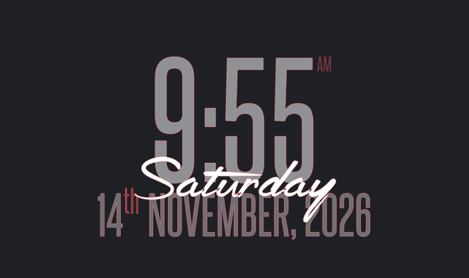

# Shadow Desktop Widgets

Two small, always-on desktop widgets for Windows, written in a single file each with
[AutoHotkey v2](https://www.autohotkey.com/) — no Rainmeter, no runtime, no installers.

- **Shadow Greeting** — a large dim greeting, live weather you can click through, and a
  rotating quote.
- **Shadow Clock** — a big font clock with the weekday and date, in the same visual style.

| | |
|---|---|
|  |  |

Both draw themselves with GDI+ into a per-pixel-alpha layered window, so they float on the
desktop with no background box and no taskbar entry. Both keep the normal arrow cursor.

---

## Requirements

- Windows 10 or 11
- [AutoHotkey v2.0](https://www.autohotkey.com/) installed (`AutoHotkey64.exe`)

`ShadowClock.ahk` also uses two display fonts that are **not** included here:

| Font | Used for |
|---|---|
| `Steelfish Rg` | time, date |
| `la Compagnie des Ombres` | weekday |

Install them first, otherwise Windows substitutes a fallback font and the spacing changes.
`ShadowGreeting.ahk` uses only Arial and can run as-is.

---

## Run it

Double-click the `.ahk` file, or from a terminal:

```powershell
& "C:\Program Files\AutoHotkey\v2\AutoHotkey64.exe" ".\ShadowGreeting.ahk"
```

Each script runs as its own tray icon. Right-click the tray icon for options, `Exit` to quit.

To start with Windows, put a shortcut to the script in:

```
%AppData%\Microsoft\Windows\Start Menu\Programs\Startup
```

---

## Shadow Greeting

`ShadowGreeting.ahk` — 600 × 248 px, centered near the bottom of the screen.

### What it shows

**Greeting (top).** Large uppercase text, stretched vertically to about 100 px caps.
It changes every 10 minutes between time-of-day greetings (morning / afternoon / evening /
night). **Click it** and it shows an alternate line for 5 seconds, then returns.

**Weather (middle).** The current temperature, with an icon and a small attribute label.
**Click it** to cycle through the other live readings; it returns to the temperature
5 seconds after the last click.

| Order | Attribute | Notes |
|---|---|---|
| 1 | Temperature | default view, `°C` / `°F` |
| 2 | Location | city, with region/country underneath |
| 3 | Precipitation | current, plus chance this hour |
| 4 | UV index | current, with a plain-language level |
| 5 | Wind | speed and direction |
| 6 | Humidity | relative humidity |
| 7 | Feels like | apparent temperature |
| 8 | Gusts | wind gust speed |
| 9 | Pressure | mean sea level |
| 10 | Cloud cover | percent |
| 11 | Visibility | kilometres |

**Quote (bottom).** A random quote with its author, refreshed every 15 minutes.

### Tray menu

| Item | What it does |
|---|---|
| Set Name (…) | change the display name live (the script's `UserName` wins on restart) |
| Set Location (…) | search a city by name and pick it from a list — saved permanently |
| Refresh Weather Now | force an immediate weather update |
| New Greeting | roll a new greeting right away |
| Draggable (On/Off) | unlock to move the widget, lock when you're happy with the spot |
| Temperature Unit (°C/°F) | toggle unit |
| Show Feels Like (On/Off) | show/hide the detail line |
| Quotes (On/Off) | show/hide the whole quote block |
| Show Quote Author (On/Off) | author line only |
| New Quote / Refresh Quotes | next quote / reload the quote pool |
| Toggle Border (On/Off) | the red outline |
| Exit | quit |

### Moving it

Tray → **Draggable (On)** → drag the widget → **Draggable (Off)**.

While locked the widget cannot be moved, but the greeting and weather still respond to
clicks. The position and the lock state are written to the settings file immediately, so
they survive restarts and reboots. If the saved spot is no longer on a monitor (changed
layout, unplugged screen), it is clamped back onto the visible desktop.

### Settings file

Location, window position and the drag lock live in:

```
%AppData%\ShadowGreeting\settings.ini
```

```ini
[Location]
auto=0            ; 1 = detect from IP, 0 = use the coordinates below
lat=30.18414
lon=67.00141
city=Quetta
label=Quetta, Balochistan, Pakistan

[Window]
x=594
y=710
draggable=0
```

Delete the file to go back to automatic IP-based location and the default position.

### Configuration

Everything adjustable is a constant near the top of `ShadowGreeting.ahk`, and the display
name is deliberately in one place only:

```ahk
; =====================================================================
;  EDIT ME  -  the display name
;  This is the ONLY place the name is written in this script. Every
;  greeting, the tray menu label and the tray tooltip read it from here
;  (greeting lines use the {name} placeholder).
;  Change the value below, then reload/restart the widget.
; =====================================================================
global UserName := "ZIA"
```

| Constant | Default | Meaning |
|---|---|---|
| `UserName` | `"ZIA"` | name used by every greeting line (`{name}`) |
| `W`, `H` | `600`, `248` | window size |
| `GreetingFont`, `GreetingSize` | `Arial`, `84` | greeting font; size auto-shrinks to fit the width |
| `GreetingClickSecs` | `5` | how long a click greeting stays |
| `GreetingRotateMs` | `10 min` | automatic greeting change |
| `WeatherClickSecs` | `5` | idle time before the weather view reverts to temperature |
| `WeatherRefreshMs` | `10 min` | weather refresh interval |
| `QuoteIntervalSec` | `15 min` | automatic quote change |
| `TempUnit` | `"C"` | `"C"` or `"F"` |
| `BorderColor` | `0xE53935` | red outline colour |
| `BottomMargin` | `120` | pixels between the widget and the bottom of the work area |

Per-element opacities are set with the `*Alpha` constants (`GreetingAlpha`,
`WeatherAlpha`, `CondAlpha`, `FeelsAlpha`, `QuoteAlpha`, `AuthorAlpha`); `255` is solid.
Note that `FadeAll` multiplies every value, so the stored number is slightly higher than
what you see.

---

## Shadow Clock

`ShadowClock.ahk` — 600 × 330 px, horizontally centered at 10% of the screen height.
It renders once a second and has no network or file access.

- **Time** — 12-hour (`h:mm`) or 24-hour (`HH:mm`), large, semi-transparent
- **AM/PM** — small, red, tucked against the top-right of the time
- **Weekday** — full weekday name
- **Date** — day with a superscript ordinal (`14`<sup>th</sup>), then `NOVEMBER, 2026`
- **Outline** — thin red outline around the time, weekday and date

### Tray menu

| Item | What it does |
|---|---|
| Toggle 12/24H (12H) | switch formats |
| Toggle Border (On/Off) | the red outline |
| Exit | quit |

### Configuration

| Constant | Default | Meaning |
|---|---|---|
| `Mode` | `"12H"` | `"12H"` or `"24H"` |
| `W`, `H` | `600`, `330` | window size |
| `TimeFont` / `WeekdayFont` / `DateFont` | Steelfish Rg / la Compagnie des Ombres / Steelfish Rg | must be installed |
| `TimeSize`, `WeekdaySize`, `DateSize` | `160`, `90`, `55` | point sizes |
| `TimeY`, `WeekdayY`, `DateY` | `1`, `175`, `225` | vertical placement |
| `TimeAlpha`, `WeekdayAlpha`, `DateAlpha` | `130`, `255`, `90` | opacity |
| `BorderColor`, `BorderAlpha`, `BorderWidth` | `0xFF5A5A`, `150`, `1.5` | outline |
| `AMPMColor`, `AMPMAlpha` | `0xFF5A5A`, `100` | AM/PM indicator |

Set `UseBorder := false` for no outline.

---

## Data sources

No API keys, no accounts.

| Use | Service |
|---|---|
| Current weather, UV, visibility, dew point | [Open-Meteo](https://open-meteo.com/) forecast API |
| City search in the location picker | Open-Meteo geocoding API |
| Automatic location (first run) | [ipwho.is](https://ipwho.is/), with ipapi.co as fallback |
| Quotes | [DummyJSON](https://dummyjson.com/quotes) |

Privacy: an IP-based lookup only happens while the location is set to automatic. Otherwise
just the saved coordinates are sent to Open-Meteo. Nothing is sent anywhere by
`ShadowClock.ahk`.

---

## How it works

- A borderless `WS_POPUP` window with `WS_EX_LAYERED | WS_EX_TOOLWINDOW | WS_EX_NOACTIVATE`
  — it never takes focus and never appears in the taskbar or Alt-Tab.
- Each frame is drawn into a 32bpp ARGB GDI+ bitmap, alphas are applied per pixel, then
  pushed to the screen with `UpdateLayeredWindow`.
- The window procedure answers `WM_NCHITTEST` with `HTCLIENT` so the whole surface is
  clickable, and dragging is done manually with `GetCursorPos` / `SetCapture` because
  caption-dragging does not work on a no-activate window.
- Everything is `DllCall`-level Win32/GDI+ from AutoHotkey — no external libraries.

## Repository layout

```
ShadowGreeting.ahk   greeting + live weather + quotes
ShadowClock.ahk      large-type clock
docs/preview.png     screenshot of Shadow Greeting
docs/clock.png       screenshot of Shadow Clock
```

## Notes

- No license is included; the code is published for reference and personal use.
- AutoHotkey scripts are sometimes flagged by antivirus heuristics; these are plain
  readable `.ahk` sources with nothing packed or obfuscated.
- The screenshots were taken at the default opacity settings, so the text is intentionally
  faint.
